# MotoForge

MotoForge is a full-stack 3D motorcycle modification configurator that lets users preview a motorcycle build before buying parts or starting fabrication. The app combines a Next.js frontend, a FastAPI backend, real-time quote logic, and a 3D viewer powered by Three.js.

## Overview

MotoForge is designed for builders, riders, and custom shops that want to:

- Start from a supported base motorcycle.
- Browse only compatible modification parts.
- View modifications in a 3D interactive configurator.
- See real-time horsepower, weight, and pricing changes.
- Export a professional quotation for the selected build.

The repository is structured as a monorepo with separate frontend and backend apps plus infrastructure and CI/CD assets.

## Core Features

- 3D motorcycle viewer with orbit controls, lighting, reflections, and mod overlays.
- Compatibility-aware parts catalog grouped by category.
- Real-time quote calculation using backend business logic.
- Performance summary for horsepower and weight changes.
- PDF quotation export for selected builds.
- Docker, Kubernetes, Cloud Run, and Vercel deployment support.
- GitHub Actions CI for linting, testing, and build verification.

## Tech Stack

### Frontend

- Next.js 14 with App Router
- React 18
- Tailwind CSS with the "build bench" design tokens in `tailwind.config.js`
- Motion (Framer Motion) for interaction animation, respecting reduced-motion settings
- Archivo variable font via `next/font`
- Axios
- jsPDF and `jspdf-autotable`, loaded only when a quote is downloaded

### 3D Layer

- Three.js
- `@react-three/fiber`
- `@react-three/drei`
- `@react-spring/three`

### Backend

- FastAPI
- SQLAlchemy
- Alembic migrations
- Pydantic Settings
- SQLite for MVP
- Uvicorn

### DevOps and Infrastructure

- Docker
- Docker Compose
- GitHub Actions
- Google Cloud Run
- Google Kubernetes Engine
- Vercel

## Architecture

MotoForge is split into two primary applications:

- `apps/web`: the user-facing configurator and landing experience.
- `apps/api`: the catalog, compatibility, quote, and seed/data layer.

The frontend talks to the backend over HTTP. The backend reads motorcycle and part data from SQLite and calculates quotes based on selected compatible parts.

## End-to-End Flowchart

```mermaid
flowchart LR
    A["User opens MotoForge"] --> B["Next.js Landing Page"]
    B --> C["Fetch motorcycles from FastAPI"]
    C --> D["User selects a motorcycle"]
    D --> E["Configurator Page loads"]
    E --> F["useBike fetches base motorcycle"]
    E --> G["useParts fetches compatible parts"]
    E --> H["BikeViewer loads GLTF base model"]
    G --> I["PartPicker renders parts by area"]
    I --> J["User fits a part (sidebar or 3D hotspot)"]
    J --> K["useBuild writes ?parts= to the URL"]
    K --> L["POST /api/quote (debounced, stale requests aborted)"]
    L --> M["FastAPI validates compatibility"]
    M --> N["Quote service calculates price, HP, and weight"]
    N --> O["QuoteResponse returned to frontend"]
    O --> P["PerformanceFigures and BuildSheet update"]
    P --> Q["User downloads PDF quote or copies the build link"]
```



## Request and Data Flow

### Landing and Catalog Pages

1. `/` is a static landing page with an interactive sample build. It runs
   entirely in the browser, using a copy of the seed data, so it works
   without the API.
2. `/product` calls `GET /api/motorcycles` and lists the bikes that can be
   configured.
3. The user picks a bike and goes to `/configurator/[bikeId]`.

### Configurator Page

1. `useBike(bikeId)` fetches the base motorcycle.
2. `useParts(bikeId)` fetches compatible modifications grouped by category.
3. `BikeViewer` renders the base GLTF model.
4. The sidebar lists compatible parts by area. Hotspots on the 3D bike open
   the matching area.
5. The build is stored in the URL (`?parts=3,7&ownsBike=true`), so copying
   the link shares the exact build.

### Quote Calculation

1. The user fits or removes a part. Each area holds one part, so fitting a
   second exhaust replaces the first.
2. `useBuild` updates the URL and requests a new quote. Older in-flight
   requests are aborted, so a slow response can't overwrite a newer one.
3. `POST /api/quote` sends the selected part IDs. Repeated IDs are counted once.
4. The backend validates compatibility against the selected motorcycle.
5. The backend computes:
   - base bike price + parts subtotal
   - new horsepower
   - new weight
   - HP gain
   - weight delta
6. The frontend shows the API's numbers. Power, weight and price figures count
   to their new values, and the power curve redraws.

### PDF Export

1. The user clicks `Download quote (PDF)`.
2. The frontend uses `generateQuotePDF(...)`.
3. The selected parts and totals are exported into a downloadable quote.

## Folder Structure

```text
motoforge/
├── .github/
│   └── workflows/
│       ├── ci.yml
│       └── deploy.yml
├── apps/
│   ├── api/
│   │   ├── app/
│   │   │   ├── models/
│   │   │   ├── routers/
│   │   │   ├── schemas/
│   │   │   ├── services/
│   │   │   ├── utils/
│   │   │   ├── config.py
│   │   │   ├── database.py
│   │   │   └── main.py
│   │   ├── migrations/          # Alembic migrations
│   │   ├── seed/
│   │   ├── tests/
│   │   ├── alembic.ini
│   │   ├── Dockerfile
│   │   ├── requirements.txt     # runtime, pinned
│   │   └── requirements-dev.txt # tests and linters
│   └── web/
│       ├── app/                 # /, /product, /configurator/[bikeId]
│       ├── components/
│       │   ├── build/           # part picker, build sheet, figures, power curve
│       │   ├── home/            # bike catalog
│       │   ├── landing/         # landing-page demo build
│       │   ├── quotation/       # PDF export
│       │   ├── ui/
│       │   └── viewer/          # 3D viewer; placeholder/ holds the procedural bike
│       ├── hooks/
│       ├── lib/
│       ├── Dockerfile
│       ├── next.config.js
│       ├── package.json
│       └── tailwind.config.js
├── infra/
│   ├── docker-compose.yml
│   └── k8s/
│       ├── api-deployment.yaml
│       ├── ingress.yaml
│       └── web-deployment.yaml
└── README.md
```

## Local Setup

### Prerequisites

- Python 3.11+
- Node.js 20+
- npm
- Docker Desktop optional

### Run Without Docker

#### 1. Backend setup

```bash
cd apps/api
python -m venv .venv
source .venv/bin/activate
pip install -r requirements-dev.txt
python seed/seed.py
uvicorn app.main:app --reload
```

On Windows PowerShell:

```powershell
cd apps/api
python -m venv .venv
.venv\Scripts\Activate.ps1
pip install -r requirements-dev.txt
python seed/seed.py
uvicorn app.main:app --reload
```

#### 2. Frontend setup

```bash
cd apps/web
npm ci
npm run dev
```

#### 3. Open the app

- Frontend: `http://localhost:3000`
- Backend: `http://localhost:8000`
- API docs: `http://localhost:8000/docs`

## Docker Setup

From the `infra/` directory:

```bash
docker compose up --build
```

This starts:

- FastAPI API on port `8000`
- Next.js frontend on port `3000`

## Environment Variables

### Frontend

`apps/web/.env.local`

```env
NEXT_PUBLIC_API_URL=http://localhost:8000
```

### Backend

Optional `apps/api/.env`

```env
DATABASE_URL=sqlite:///./motoforge.db
CORS_ORIGINS=["http://localhost:3000"]
APP_ENV=development
API_RATE_LIMIT_PER_MINUTE=180   # 0 turns rate limiting off
TRUST_PROXY_HEADERS=false       # true only behind a proxy you control
AUTO_MIGRATE=true               # false if migrations run as a deploy step
```

The rate limiter keeps its counts in each API process. With several replicas,
limit at the ingress or load balancer instead.

## Database Migrations

The schema is managed with Alembic in `apps/api/migrations/`. By default the
API applies pending migrations on startup, and `seed/seed.py` does the same.

Databases created before Alembic was added are detected automatically: missing
columns are added, the database is marked as the baseline revision, and then
it is upgraded as normal.

After changing a model:

```bash
cd apps/api
alembic revision --autogenerate -m "describe the change"
alembic upgrade head
alembic check   # CI fails if the models and migrations disagree
```

## Seeding the Database

Seed the default MotoForge catalog:

```bash
cd apps/api
python seed/seed.py
```

The seed adds 11 motorcycles (naked, sport, retro and cruiser) and 34 parts
across exhausts, suspension, wheels, fairings and handlebars. Each part is
linked to every bike in the riding segments it supports. Re-running the seed
updates existing rows rather than duplicating them.

## Running Tests

### Backend tests

```bash
cd apps/api
python -m pytest tests/
```

### Frontend build verification

```bash
cd apps/web
npm run build
```

### CI checks

GitHub Actions runs:

- API formatting and lint checks with `black --check` and `flake8`
- A check that the Alembic migrations match the models
- API tests with `pytest`
- Web linting
- Web production build

## CI/CD

### CI Workflow

`.github/workflows/ci.yml` runs on:

- push to any branch
- pull request targeting `main`

It validates:

- API style and formatting
- API tests
- Frontend linting
- Frontend build success

### Deployment Workflow

`.github/workflows/deploy.yml` runs on pushes to `main`.

It performs:

- API Docker build and push to Google Artifact Registry
- API deployment to Cloud Run in `us-central1`
- Frontend production build
- Frontend deployment to Vercel

Required GitHub secrets include:

- `GCP_SA_KEY`
- `NEXT_PUBLIC_API_URL`
- `VERCEL_TOKEN`
- `VERCEL_ORG_ID`
- `VERCEL_PROJECT_ID`

## Deployment to GCP

### Cloud Run API

The API deploy pipeline builds `apps/api/Dockerfile`, pushes the image to Artifact Registry, and deploys the service as:

- service name: `motoforge-api`
- region: `us-central1`

### GKE Option

Kubernetes manifests are included in `infra/k8s/` for:

- API deployment and service
- Web deployment and service
- Ingress routing

Ingress rules route:

- `/api/*` to the FastAPI service
- `/*` to the Next.js service

### Vercel Frontend

The web deployment job builds the app and deploys it to Vercel. In production, `NEXT_PUBLIC_API_URL` should point to the deployed API endpoint.

## Development Notes

- SQLite is used for MVP simplicity. For production, move to Cloud SQL or another managed relational database.
- The quote flow is backend-driven, so compatibility and pricing rules stay authoritative.
- GLTF and GLB model paths are expected to come from the backend catalog.
- Real asset drop-in targets now live under `apps/web/public/models/` with a
  concrete manifest at `apps/web/public/models/asset-manifest.json`.
- Keep the current placeholder URLs in the seed data until the matching `.glb`
  assets have been added locally and validated in the viewer.
- Local `.env.local`, database files, and generated caches should not be committed.

## Contributing

1. Create a feature branch from `main`.
2. Keep changes scoped to a clear feature or fix.
3. Run backend tests before opening a pull request.
4. Run frontend build checks for UI-affecting work.
5. Update docs when setup, deployment, or architecture changes.
6. Avoid committing secrets, local env files, or generated cache artifacts.

## Roadmap Ideas

- Authentication, and builds saved to an account (builds can already be shared by link)
- Build comparison mode
- More motorcycles and part categories
- Dealer-ready branded quote templates
- Persistent 3D model asset pipeline
- Production-grade PostgreSQL support

## License

Add a project license file before open-sourcing or commercial distribution.
